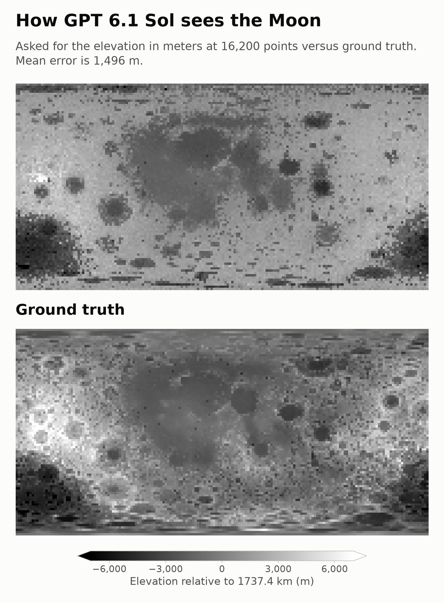

# MoonMapBench

How does a blind model see the Moon? A Moon version of
[How does a blind model see the Earth?](https://outsidetext.substack.com/p/how-does-a-blind-model-see-the-earth).

The Earth post asks a model "Land or Water?" at the centre of every pixel of an
equirectangular lat/lon grid and draws the answers as an image. Here we ask for the
**lunar elevation in meters** instead and compare it to the real Moon.

## Method

- **Grid:** equirectangular, `res` degrees per pixel, one query at each pixel centre
  (same as the Earth post). Default `res = 22.5°` gives a 16 × 8 image = 128 queries.
  The Earth post mostly used 2° (180 × 90 = 16,200 queries).
- **Prompt** (one user message, no system prompt, no tools):

  > Say the elevation of this location on the Moon in meters, relative to the lunar
  > reference radius of 1737.4 km. If you are unsure, give your best guess. Say only
  > the number. Do not say anything else. 11.25° S, 33.75° W

  Without the "best guess" sentence, gpt-6.1-sol refused ("I don't know.", "Unknown")
  for about half of the points in a pilot. The Earth post forces a Land/Water choice, so
  we force a number in the same way.
- **Samples:** 1 answer per pixel by default (`--samples N` averages N answers, as the
  Earth post averaged its n=4 samples per pixel).
- **Ground truth:** LRO LOLA global DEM
  [LDEM_16](https://imbrium.mit.edu/DATA/LOLA_GDR/CYLINDRICAL/IMG/LDEM_16.LBL)
  (data set LRO-L-LOLA-4-GDR-V1.0, NASA Planetary Data System;
  16 pixels/degree, ~1.9 km/pixel, heights relative to the 1737.4 km sphere),
  bilinearly interpolated at each pixel centre.
- **Metric:** mean absolute error (MAE) over all pixels: how far off the estimates
  are on average, in meters. For context we also report
  - the MAE of always answering 0 m, and
  - the MAE of answering each pixel's exact cell-average elevation. The truth is the
    height at one point, so even a model that knew every cell's average would not score 0.

  An equirectangular grid has more pixels per area near the poles, and every pixel counts equally.

## Results

| Model | Effort | Grid | Samples/pixel | MAE | Always 0 m | Exact cell average |
|---|---|---|---|---|---|---|
| gpt-6.1-sol | low | 22.5° (16 × 8) | 1 | **1,514 m** | 1,925 m | 925 m |
| gpt-6.1-sol | low | 7.5° (48 × 24) | 1 | **1,483 m** | 1,754 m | 735 m |
| gpt-6.1-sol | low | 2° (180 × 90) | 1 | **1,496 m** | 1,788 m | 405 m |



The ground truth is LOLA at the 2° pixel centres, the values the model is scored against.
Side by side: [with full-detail LOLA](results/gpt-6.1-sol__low/res2_n1/side_by_side.png),
[with LOLA at the same resolution](results/gpt-6.1-sol__low/res2_n1/side_by_side_same_res.png).

At 2° (the Earth post's usual resolution) the model's map shows the nearside maria in
their real outline and individual basins in roughly the right places: Orientale as a round
depression near 95°W 20°S, Crisium, Smythii, Humboldtianum and the South Pole–Aitken basin.
Near the poles it often repeats one value along a row, which shows up as horizontal streaks.
It underestimates the farside highlands (bright from 150°W to 180°W near the equator) and has
little of the crater-scale roughness of the real map.

The MAE stays at about 1.5 km at every resolution, while the exact-cell-average reference
drops from 925 m to 405 m. So the error comes from what the model does not know, not
from the coarse grid.

Other figures: [`res2_n1/maps.png`](results/gpt-6.1-sol__low/res2_n1/maps.png) (with LOLA
sampled at the same points), [7.5°](results/gpt-6.1-sol__low/res7.5_n1/side_by_side.png),
[22.5°](results/gpt-6.1-sol__low/res22.5_n1/side_by_side.png).
The 7.5° grid contains every 22.5° pixel centre, so it reused those 128 answers.

## Running

Needs `uv` and an API key, either in the environment or in a `.env` file in the
repository root (the environment wins):

- OpenAI models: `OPENAI_API_KEY`. Queries go to the
  [Chat Completions API](https://platform.openai.com/docs/api-reference/chat) with
  `reasoning_effort`, through the official `openai` Python package.
- Claude models (`claude-*`): `ANTHROPIC_API_KEY`. Queries go to the
  [Messages API](https://platform.claude.com/docs/en/api/messages) with adaptive thinking
  and `output_config.effort`, through the official `anthropic` Python package. A refusal stops
  the run; no other model answers in its place.

```
# .env
OPENAI_API_KEY=...
ANTHROPIC_API_KEY=...
```

```bash
scripts/run.sh                                   # gpt-6.1-sol, low effort, 22.5°/px, 1 sample
scripts/run.sh --res 10 --samples 4 --effort medium
scripts/run.sh --res 7.5 --concurrency 64                 # fewer parallel requests
scripts/run.sh --model claude-opus-5-5 --effort low       # Claude Opus 5.5
scripts/run.sh --model claude-opus-5-5 --points 20        # 20 queries only, as a cheap test
```

`--points N` queries only N grid points, picked at random with a fixed seed, and skips the
report, which needs the whole grid. At the end the script prints the tokens of all saved
answers of that model and effort, and their cost at list price for models in
`PRICES_PER_MTOK` in `moonmapbench/cost.py`. This is a lower bound on what was spent:
requests that failed or were cancelled are billed too, but not saved.

Requests run in parallel, up to `--concurrency` (default 256) at a time. When the API
answers "Too Many Requests" (HTTP 429), the number of requests in flight drops by 20% and
slowly grows back. Retries wait a random, growing time. A run stops when the account is
out of quota.

The script queries the model, writes the report and prints the cost.
The Python environment lives in `~/.local/share/venvs/moonmapbench`.
Every answer is appended to `results/<model>__<effort>/responses.jsonl` as soon as it
arrives. A rerun only queries missing (lat, lon, sample) entries, so an interrupted run
resumes, and a later grid reuses any pixel centres it shares with an earlier one.
The LOLA DEM (33 MB) is downloaded to `data/` on first use and checked by sha256.

Outputs per run in `results/<model>__<effort>/res<res>_n<samples>/`:
`metrics.json`, `points.csv` (truth, prediction and raw answers per pixel), `maps.png`,
`side_by_side.png` (real Moon next to the model's map), `side_by_side_same_res.png`
(the same, with the real Moon at the grid's resolution) and `stacked.png` (the model's map
above the ground truth at the grid's resolution).

## License

Code, figures and results are under the MIT license (see `LICENSE`). The ground-truth
heights come from NASA's Planetary Data System and are in the public domain. If you use
them, please cite the LOLA data set LRO-L-LOLA-4-GDR-V1.0.
